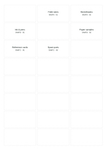

# Sheetmint

**A place for every label.**

Plan measured, two-line text label sheets in your browser. Mark scattered used positions on the first sheet, inspect each page, and export standalone SVG sheets without uploading your label text.

## Features

- A4 and US Letter paper with editable millimeter geometry.
- Rows, columns, label dimensions, margins, and gaps that must fit the page.
- Arbitrary used positions on the first sheet; later sheets start fresh.
- One- or two-column tab-separated text, kept in input order.
- Local Arial measurements with explicit width/height warnings and a guarded SVG download button.
- Optional test outlines and a separate 100 mm scale-check SVG.
- Editable JSON projects and placement records containing the actual label text and coordinates.
- No accounts, uploads, analytics, remote fonts, or app storage.

## Example output



This is an actual generated SVG output, **not a screenshot of the editor**. A real editor screenshot remains pending because the browser capture service timed out; visual screenshot review is not claimed.

## Run locally

Node.js 22 or newer. No dependencies to install.

```sh
git clone https://github.com/KingReaper6940/sheetmint.git
cd sheetmint
npm test
npm run build
npm run dev
```

Open http://127.0.0.1:4186. The preview server serves allowlisted build assets on loopback.

## Use

1. Measure your paper and label grid, then enter its dimensions. The default A4 layout is **generic**, not an official manufacturer template.
2. Mark used positions on the first sheet. Numbers run left to right, top to bottom.
3. Paste one label per line. Use a tab between the title and optional second line; do not include a header. Blank lines are ignored and outer whitespace is trimmed.
4. Review the fit audit and each page. Shorten text, reduce the font, or adjust dimensions if a fit issue appears.
5. Download **this sheet SVG** for each page. Turn test outlines off for text-only output.
6. Save an editable project to retain measurements and source text. Reopen it by pasting its JSON under **Reopen a saved project**.

Example paste (the separator is a tab):

```text
Field notes	Shelf A · 01
Sketchbooks	Shelf A · 02
Ink & pens	Shelf B · 01
```

Changing rows or columns clears the used-position selection because the positions refer to that grid. Switching paper does not automatically resize the grid; an out-of-bounds layout must be adjusted explicitly. Invalid geometry clears the preview and SVG source. A rejected project import preserves the current job.

## Physical output

SVG pages declare their physical width and height in millimeters, with matching viewBox coordinates. Open them in a compatible SVG viewer/editor and print at actual size / 100%. This app does not operate a printer or generate PDF files.

Start with a plain-paper test. The 100 mm scale-check line runs between the ticks at x=10 and x=110 mm; it checks output scale, not feed direction or label alignment. Printer margins, drivers, viewer scaling, stock tolerances, and font substitution can affect the physical result. Check your printer's instructions before reusing partially used label stock.

Test outlines include all positions, including used ones. They are intended for plain-paper checks. With outlines off, used positions contain no label text or outline.

## Data and examples

- [Editable project](examples/project.json)
- [Generated sheet](examples/sheet.svg)
- [Scale check](examples/scale-check.svg)
- [Placement record](examples/placements.json)

Regenerate these fictional examples with `node scripts/example.mjs`. That script uses a simple approximate text-width function for its fixture audit. The browser uses actual local Canvas text measurements. Neither is a physical printing test.

Projects and placement records include all label text. SVG keeps text as text, not raster pixels. XML characters are escaped. No SVG, image, markup, or remote URL import is supported.

## Limitations

- Text only: up to two lines per label, 80 UTF-16 units per line, 300 labels, 50,000 input units, and 20 sheets.
- Up to 60 positions per sheet; 1–6 columns and 1–12 rows. A fully used first sheet is rejected rather than silently exporting a blank sheet.
- Project JSON is limited to 120,000 characters. No CSV quoting, multiline cells, template database, images, barcodes, or mail sending.
- Labels do not wrap, shrink, or truncate automatically. Padding is 2 mm. The font size is 8–24 points; secondary text is 82% of it.
- Browser Canvas checks horizontal text width and a conservative line-height estimate. This is not a pixel-perfect guarantee of glyph bounds.
- SVG uses local Arial/sans-serif fonts, which are not embedded. Font availability and shaping may differ in another viewer. Preview and physically test on the printing device.
- No automatic print offsets, calibration correction, stock compatibility certification, bleed, crop marks, PDF creation, or native printing.
- No persistence. Save a project before closing. Browser extensions, clipboard, downloaded files, and the hosting environment remain outside the app's control.
- Native download destinations and physical printer output were not verified. Browser preview dimensions, SVG content, geometry, and interaction flows were verified.

## Checks

`npm test` runs 12 tests covering geometry, bounded parsing, project round trips, XML escaping, overflow audits, page caps, empty positions, and 28 measured grid configurations that preserve every record exactly once. CI runs Node 22 and 24 on Windows and Linux.

Browser checks cover scattered used positions, 25-label pagination, wide text blocking sheet download, invalid geometry clearing output, project reopening, rejected imports, a US Letter page, and a 390px mobile viewport with no page overflow. No browser console errors were observed.

## Deploy to Vercel

Import this GitHub repository with **Other** as the framework, root directory `.`, build command `npm run build`, output `dist`, and an empty install command. The configuration is in `vercel.json`. No environment variables, database, server functions, paid APIs, or external storage are needed.

## Related tools

[MakeMyStickers' partial-sheet guide](https://makemystickers.app/guides/print-on-partially-used-label-sheets) describes skipping used positions and plain-paper checks. [Browser Kitty](https://browser-kitty.com/en/tools/label-sheet-maker/) already offers measured geometry, data merge, partial sheets, and PDF output; [LabelStudio](https://labelstudio.io/) offers custom layouts and SVG export. Sheetmint is a bounded text-only workflow, with no novelty or market-demand claim.

MIT licensed. See [LICENSE](LICENSE).
